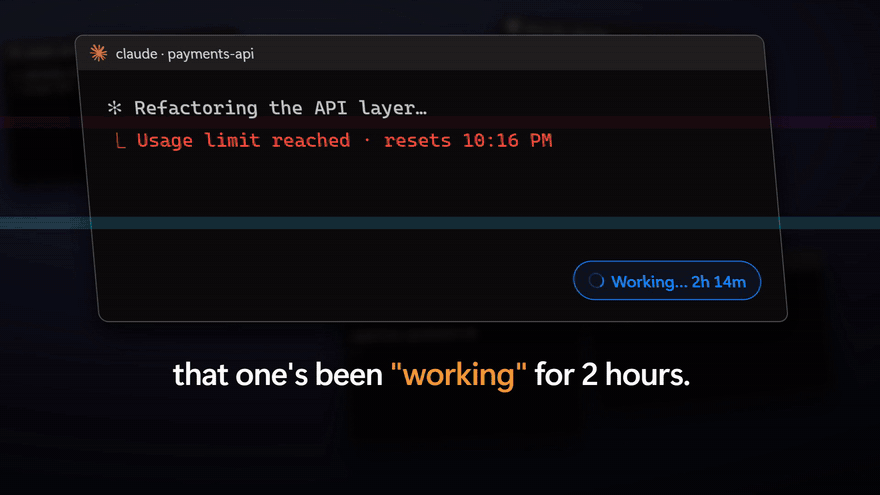

<div align="center">

# Agent Notch

**All your coding agents. One notch.**

A Dynamic-Island-style notch for Windows that shows what every coding agent is doing, which ones need you, and lets you answer them without hunting for the terminal.

[](https://github.com/KurianJose7586/notch/releases/download/v0.3.1/AgentNotch-promo.mp4)

[**Watch the 51s demo**](https://github.com/KurianJose7586/notch/releases/download/v0.3.1/AgentNotch-promo.mp4) · [**Download for Windows**](https://pub-671421c125c0425e9c137b3baf67b496.r2.dev/AgentNotch-Setup.exe)

</div>

## Works with

| Agent | Where |
|---|---|
| Claude Code | terminal and the Claude desktop app |
| Antigravity | `agy` CLI and the Antigravity IDE |
| OpenCode | terminal |
| Kilo | terminal |
| GitHub Copilot | VS Code agent chat |

## Features

- **One glance**: every agent grouped by project, with its state (working, needs you, done, stopped), current task, last action and progress.
- **Needs you?** The notch glows and peeks the request. Press **Y** to allow or **N** to deny, or jump straight to that terminal.
- **AUTO for Antigravity**: presses Enter on `agy`'s permission prompts for you, only when the prompt is actually on screen.
- **Approve from your phone**: switch it on in Setup, scan the QR code, and your phone shows the same request with big **Allow** / **Deny** buttons, buzzing when an agent needs you.
- **Team messages**: agents working in the same git repo, yours and your teammates', any provider, can message each other and see who is working on what. It goes through the repo's own remote, so there's nothing to host. Off until you turn it on.
- **Grid**: one click (or **Ctrl+Alt+G**) tiles every agent window.
- **Usage limits**: Claude's 5-hour and weekly limits as bars, with a heads-up at 80% and 95%. An agent that hits a limit or an error shows **Stopped**, not "Working".
- **Launch agents** from the notch: several at once, including several of the same one (a − / + stepper per provider, up to 8), optionally each in its own git worktree. Turn on **SPLIT** and every line you type becomes its own agent with its own task.
- **Sleep and move**: put the notch to sleep and it shrinks to a small dim "zzz", quiet until an agent needs you (then it wakes by itself, and sleeps again afterwards). Drag it along the top of any monitor by its pill or panel header; it snaps to the centre and remembers where you left it.
- **Updates itself**: it checks GitHub for a new release every few hours, downloads it quietly, tells you when it's ready, and installs it when you quit.
- **Restart** a terminal agent from its row (**↻**, on hover): it comes back in the same window and the same conversation, with anything set up since it started. A busy agent restarts as soon as it finishes.
- **Rename** sessions, unread markers, timers, sound, and a full keyboard mode.
- **Alive**: after a long quiet spell the notch gets up to mischief: the agents try to escape and black tendrils grab them back, Pac-Man eats their dots, or they juggle. Press **Ctrl+Alt+V** to play the next one. A closed, quiet notch also grows eyes that follow your cursor when it lingers nearby, and reacts to what happens: a happy squish when everything finishes, a grumpy shake when an agent stops or Claude is nearly out, and an impatient nudge if a request waits. All of it stays off while anything is working, stops the moment you touch the notch, and can be turned off in Setup (**Idle animations**).
- **Starts itself** when an agent starts, and uses about 0.4% CPU when idle.

## Install

1. Download `AgentNotch-Setup-<version>.exe` from the [latest release](https://github.com/KurianJose7586/notch/releases/latest) and run it. It installs for your user only; no admin needed.
2. The first run opens a setup sheet: switch on the agents you use.
3. Start an agent. It shows up in the notch.

The installer isn't code-signed yet, so Windows SmartScreen may say "Windows protected your PC". Click **More info → Run anyway**.

### Already installed?

Download the latest installer and run it. It updates in place and keeps your settings and connected agents. **Versions before 0.3.0 can't update themselves, so this one manual step is needed once.** From 0.3.0 on, new versions arrive on their own: an "Update ready" notice appears in the notch, and the update installs when you quit (or click **Restart now**). You can turn the automatic check off in **Setup**; **Check now** still works.

Requirements: Windows 10 or 11. Terminal agents are found in Windows Terminal or any console window.

## Keyboard

| Anywhere | |
|---|---|
| **Ctrl+Alt+N** | Open the notch with the keyboard |
| **Ctrl+Alt+J** | Jump to the next agent that needs you |
| **Ctrl+Alt+G** | Tile all agent windows |
| **Ctrl+Alt+R** | Reload the notch |
| **Ctrl+Alt+V** | Play an idle animation (press again for the next one) |
| **Ctrl+Alt+Z** | Put the notch to sleep, or wake it |
| **Ctrl+Alt+Q** | Quit (agents won't restart it) |

| In the notch | |
|---|---|
| **↑ ↓** | Select an agent |
| **↵** | Open its terminal |
| **Y / N** | Allow / deny its request |
| **A** | Toggle AUTO |
| **R / D** | Rename / dismiss |
| **+** | New agent |
| **G / C** | Tile windows / clear finished |
| **T** | Team messages |
| **S / ,** | Sound on or off / Setup |
| **Z** | Sleep / wake |
| **← →** | Move the notch along the top (**Home**: back to the centre) |
| **I** | All shortcuts |

## Approve from your phone


Off by default. Turn it on in **Setup → Approve from your phone** and scan the QR code with your phone's camera. It opens a small web page from your PC, so there is no app to install and nothing goes through the internet.

- Works on the same Wi-Fi as your PC. Windows may ask to let Agent Notch through the firewall the first time: choose **Private networks**.
- The link contains a secret token. Anyone on your network who has it can approve requests, so don't share it. **New link** in Setup replaces the token and cuts off every phone paired before.
- The phone can only allow or deny requests that are waiting right now, and can't do anything else. Requests wait up to 55 seconds for an answer while this is on (30 otherwise); after that the agent asks in its own terminal as usual.
- Buzzing works on Android. iPhones show the request but can't vibrate a web page.
- It listens on port 47801. The hook server agents talk to stays on `127.0.0.1` only.

## Team messages

Off by default. Turn it on in **Setup → Team messages** (each teammate in their own notch), then restart running agents so they get the tools: **Restart agents** right there, or **↻** on an agent's row. From then on, agents working in the same git repo can talk to each other, whoever runs them and whichever agent they are: your Claude Code and your OpenCode on this PC, and your teammates' Copilot or Antigravity on theirs.

- **Two tools.** `team_send` (a note to everyone in the repo, to one teammate's agents, or to one agent) and `team_check` (who else is working in the repo and on what, plus new messages; it can wait for a reply).
- **Messages arrive by themselves.** Claude Code and Copilot get new ones after their next tool call or prompt, Antigravity before its next step, and OpenCode and Kilo with their next tool result. When a task starts, Claude, Copilot and Antigravity are also told who else is working in the repo. A message addressed to one of those three just as it finishes keeps it going once to read it.
- **Coordinate.** Switch on **Coordinate** in a repo's Team view (**T**) and your agents there work with the team as one: each new task comes with ground rules (claim your part, flag changes others depend on, don't send messages that only say OK), and an agent that finishes doesn't go idle. It's handed the team's new messages, or told to wait for them, until one agent sends a message marked done or the team has been quiet for 10 minutes. Team messages need no approval while it's on. Each person switches it on for their own agents. (Claude Code, Copilot and Antigravity are kept going; OpenCode and Kilo get the same rules.)
- **You see it happen.** When one agent messages another, the message flies across the notch from the sender's icon to the receiver's; hover it to open the conversation. In the panel, teammates' agents show up under your own in each project, with what they're working on, and the 💬 chip (or **T**) opens the whole thread.
- **Names** are the names you give sessions in the notch (**R** to rename), or the agent's kind: `kurian/claude`, `bob/api`.
- **It goes through the repo's own remote**, as commits under `refs/notch/*`: never branches or tags, never your working tree. Anyone who can push to the repo is on the team, and nobody else; on a public repo, anyone can read them. Offline, messages wait and go out when the remote is back. Nothing is pushed to a repo until someone sends the first message there; from then on, everyone's agents in it see each other.
- **What teammates see:** your agents' names and the task each is on (the start of your last prompt to it), on repos where team messages are in use.
- **You stay in charge.** Messages reach agents as information from colleagues, not as instructions from you, and agents still ask before doing anything. Claude asks you before sending, unless you allow it for good. Messages from teammates also show in the notch.

## What connecting an agent changes

Each switch in Setup adds (or removes) one hook in that agent's own config, and keeps a `.bak` copy of the file the first time. Nothing else is touched.

| Agent | File |
|---|---|
| Claude Code | `~/.claude/settings.json` |
| Antigravity (CLI and IDE) | `~/.gemini/config/hooks.json` |
| OpenCode | `~/.config/opencode/plugins/agent-notch.js` |
| Kilo | `~/.config/kilo/plugins/agent-notch.js` |
| VS Code Copilot | `~/.copilot/hooks/agent-notch.json` |

**Claude usage limits** is a separate switch in Setup. It uses Claude Code's status line, and is never turned on over a status line you've set up yourself. The desktop app doesn't report limits, so they update from Claude Code in a terminal.

**Team messages** adds an `agent-notch` MCP server to each connected agent's own MCP config while it is on, and takes it out again when you turn it off: `~/.claude.json` (Claude Code), `~/.gemini/config/mcp_config.json` (Antigravity), `~/.config/opencode/opencode.json(c)` (OpenCode), `~/.config/kilo/kilo.json(c)` (Kilo), `~/.copilot/mcp-config.json` (Copilot; VS Code asks you to trust it the first time).

Everything stays on your machine: agents talk to the notch over `127.0.0.1` only. What leaves your PC is the update check, which asks GitHub for the latest release, and, only if you turn on team messages, messages and your agents' names and tasks, which go to the remote of the repo they're working in.

Uninstalling removes all of these hooks before deleting the app.

## Run from source

Needs Node 20+.

```bash
npm run setup          # install dependencies, connect every agent found, start the notch
npm start              # start it again later
npm test               # self-tests
npm run remove-hooks   # disconnect every agent
```

## Build and release

```bash
npm run dist           # builds dist/AgentNotch-Setup-<version>.exe
```

To publish a release, push a version tag. GitHub Actions builds the installer on Windows and attaches it to a release for that tag; the tag sets the version.

```bash
git tag v0.3.0
git push origin v0.3.0
```

## Repository layout

| Path | What |
|---|---|
| `main.js` | Electron main process: the notch window, local event server, shortcuts |
| `index.html`, `preload.js` | The notch UI |
| `state.js` | Turns each agent's hook events into one session model |
| `hook.js`, `plugin.js` | What agents run: the hook script, and the OpenCode/Kilo plugin |
| `phone.js`, `phone.html` | Approve from your phone: the Wi-Fi server, pairing token, and the phone page |
| `team.js`, `mcp.js` | Team messages: the git transport and roster, and the MCP server agents load for `team_send` / `team_check` |
| `setup.js` | Connects and disconnects agents' configs |
| `launch.js` | Launches agents (and git worktrees) in Windows Terminal |
| `win.ps1` | Win32 helpers: find, focus, tile, read and press Enter in terminal windows |
| `boot.js` | Entry point that routes to the app, the hook, or the uninstaller |
| `build/` | Installer icon, NSIS script and the hook launcher |
| `promo/` | Source of the demo video, made with [HyperFrames](https://hyperframes.heygen.com) |
| `team-launch/` | Source of the Team messages launch video, also made with HyperFrames |
| `docs/` | README media |

## License

[MIT](LICENSE)
